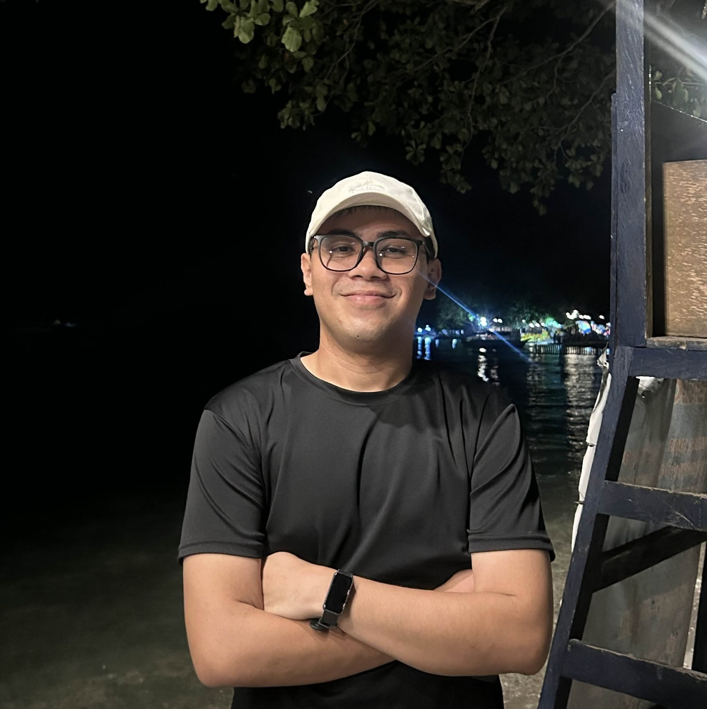

# Kent Brylle L. Alvarez — Web Developer & IT Specialist Portfolio

A clean, modern, and production-ready Web Developer Portfolio website engineered with Python (Flask), Tailwind CSS, Vanilla JavaScript, and optimized for Vercel serverless deployment.



## ⚡ Tech Stack & Architecture

- **Backend Framework**: Python 3.11+ / Flask
- **Frontend Styling**: Tailwind CSS (Obsidian & Emerald Glassmorphism theme)
- **Typography**: Plus Jakarta Sans (headings/body) & JetBrains Mono (monogram, badges, code)
- **Interactivity**: Pure Vanilla JavaScript (theme toggle, mobile navigation, passive scroll indicators, 1-click clipboard copy)
- **Deployment Platform**: Vercel Serverless WSGI (`@vercel/python`)

## 🚀 Featured Projects

- **[Expenses Tracker](https://github.com/Brylle1501/expenses-tracker-web)**: Full-stack expense management and budgeting application with local state handling and clean data visualization (Python, Flask, Tailwind CSS, Vanilla JS).
- **[ElderCare Prototype](https://github.com/noelbanac/eldercare_rcfms_v2)**: Smart healthcare monitoring assistance prototype designed for senior support and real-time tracking logic (Dart / Flutter, Python, PLpgSQL, JavaScript).

## 🛠️ Local Development

1. **Clone the repository**:
   ```bash
   git clone https://github.com/Brylle1501/portfolio.git
   cd portfolio
   ```

2. **Install dependencies**:
   ```bash
   pip install -r requirements.txt
   ```

3. **Run the local development server**:
   ```bash
   python app.py
   ```
   Open `http://127.0.0.1:5000` in your browser.

## 🌐 Live Production & Deployment

- **Official Portfolio Domain**: [https://kentbrylle.dev](https://kentbrylle.dev)
- **Vercel Production URL**: [https://kentbrylle-dev.vercel.app](https://kentbrylle-dev.vercel.app)
- **Vercel Primary Alias**: [https://portfolio-vibe-coder6.vercel.app](https://portfolio-vibe-coder6.vercel.app)

The project is structured with `vercel.json` for seamless deployment on Vercel:

```bash
vercel --prod
```

## 📬 Contact & Connect

- **Name**: Kent Brylle L. Alvarez
- **Location**: Canocotan, Tagum City, Davao del Norte, Philippines
- **Phone**: +63 951-154-2848
- **Email**: kentbryllealvarez@gmail.com
- **GitHub**: [github.com/Brylle1501](https://github.com/Brylle1501)

